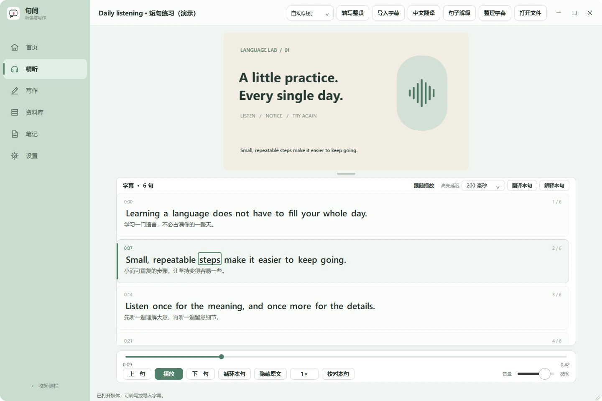
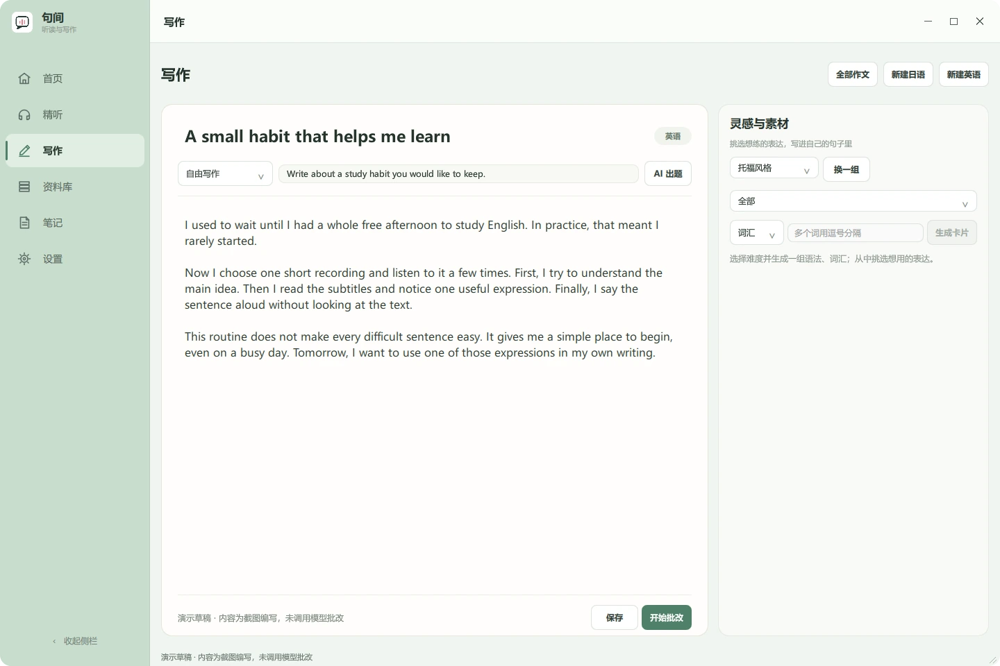

# 句间 · Mainichi Nihongo

Windows 桌面精听与写作练习工具，支持日语、英语。打开音视频，逐句听、看字幕、查解释；写作时获得中文反馈。

使用 Python、PySide6 / QML、Whisper 和大模型接口开发，开发过程中使用 AI 辅助实现与迭代。目前主要在 Windows 11 上验证。

## 界面预览





截图来自实际应用；视频、字幕、译文和作文为独立编写的演示内容，不是模型效果评测或个人学习记录。

## 功能

- **音视频精听**：本地播放、字幕导入、Whisper 转写、逐句跳转、循环、变速和逐词高亮。
- **连续字幕卡片**：全部原文加粗，视频保持比例；拖动视频下方分隔线调整高度，可校准高亮延迟。
- **英语短句整理**：基于原有逐词时间戳缩短练习单元，保留原文、人工校对与处理前备份。
- **翻译与解释**：中文翻译、词汇和语法解析；各任务可选择云端 API 或本地 Ollama。
- **写作练习**：日英作文编辑、批改反馈和本地草稿保存。
- **学习资料管理**：最近学习、已听完状态、语言分类、收藏、笔记、八种主题及自定义快捷键。
- **B 站链接下载**：解析并下载可访问的音视频；可用性及清晰度取决于链接、平台与登录权限。

## 快速开始（源码版）

### 1. 安装并启动

需要 Windows 10/11、[Python 3.11，64 位](https://www.python.org/downloads/windows/) 和 [Git for Windows](https://git-scm.com/download/win)。安装 Python 时保留 Python Launcher（`py`）。也可以下载仓库 ZIP 并解压，跳过 Git 克隆命令。

在 PowerShell 中运行：

```powershell
git clone https://github.com/Normanchine/mainichi-nihongo.git
cd mainichi-nihongo
Set-ExecutionPolicy -Scope Process Bypass
.\setup.ps1
.\run.cmd
```

`setup.ps1` 创建独立的 `.venv` 并安装依赖，无需编辑源码或配置文件。依赖包含 PyTorch / Qt，首次下载量较大，请预留数 GB 空间和可访问 Python 包源的网络。以后双击 `启动句间.cmd` 或运行 `run.cmd`。

> Git 克隆提供源码，不含 EXE、个人学习数据或模型权重。`启动句间.cmd` 在存在完整打包版时打开 EXE，否则运行已安装依赖的源码版。

### 2. 在设置中配置 API Key

首次安装默认将翻译、解释和作文设为云端；已有用户配置保持原样。

1. 打开 **设置 → 模型**。
2. 填写服务商的 **Chat Completions 接口根地址**及账户可用的**模型名**。
3. 确认“翻译 / 解释 / 作文”均选择 **云端 API**。
4. 输入自己的 API Key，点击 **保存密钥**，同时保存当前设置。以后更改模型或后端，点击 **保存设置**。
5. 在作文页提交一小段文字，或导入字幕后点击“翻译本句”，检查配置是否可用。

| 服务 | 接口根地址 | 模型填写方式 |
| --- | --- | --- |
| DeepSeek | `https://api.deepseek.com` | 例如 `deepseek-flash`，以当前支持列表为准 |
| 阿里云百炼 | 控制台提供的 OpenAI 兼容地址，包含 `/compatible-mode/v1` | 账户已开通的文本模型；Key 与地址地域须匹配 |
| 其他兼容服务 | 服务商提供的根地址，常以 `/v1` 结尾 | 需支持 Chat Completions 和 JSON 对象输出；并非所有服务都已实测 |

也可填完整的 `/chat/completions` 路径，程序不会重复拼接。不要填写 Anthropic 格式地址。

配置示例依据 [DeepSeek 官方文档](https://api-docs.deepseek.com/) 与 [百炼官方文档](https://help.aliyun.com/zh/model-studio/compatibility-of-openai-with-dashscope)；模型、地域和计费以服务商为准。调用使用你自己的账户额度。

**云端翻译、解释和写作不需要 Ollama，也不需要修改代码。** API Key 保存在 Windows 凭据管理器，不写入仓库或 `settings.json`。

### 3. 开始精听

1. 首页点击 **本地文件**，选择音频或视频。
2. 有字幕时点击 **导入字幕**；没有字幕时选定 **英语 / 日语**，再点击 **转写整段**。不确定语言时可选自动识别。
3. 转写后点击 **中文翻译 / 句子解释**，也可只处理当前一句。
4. 使用下方“上一句 / 下一句 / 循环本句”，或在设置里录入自己的快捷键。

Whisper **在本机转写音轨**，不使用聊天 API Key。首次转写下载 `small` 模型到 `models/`（约 460 MB），此后可离线转写。CPU 可以运行，兼容 NVIDIA GPU / CUDA 版 PyTorch 可加速。仅写作、播放或导入已有字幕，不需要先下载 Whisper。程序通过依赖提供解码，无需单独安装系统 FFmpeg。

默认快捷键：上一句 `Ctrl+Left`、下一句 `Ctrl+Right`、播放/暂停 `Space`、循环 `Ctrl+L`。仅在精听页且没有编辑文本时触发。

## 可选：本地 Ollama

安装并运行 [Ollama](https://ollama.com/)，服务地址为 `http://127.0.0.1:11434`。

应用使用本地模型名称 `qwen3-8b-nothink:latest`。可按下面命令创建这个本机模型，无需修改应用源码：

```powershell
ollama pull qwen3:8b
@'
FROM qwen3:8b
PARAMETER temperature 0.1
SYSTEM /no_think
'@ | Set-Content -Encoding ascii Modelfile
ollama create qwen3-8b-nothink -f Modelfile
```

在设置中将所需任务切换为 **本地 Ollama** 并保存。8B 模型需要额外内存、磁盘和计算资源。

**英语字幕整理**需要已有逐词时间戳。云端配置下使用本机规则分段，整理后点击“中文翻译”补译；选择本地解释后端时可让 Ollama 辅助选择切点，选择本地翻译后端时逐段翻译。无效模型切点回退到规则。处理前项目备份在 `data/subtitle-backups/`，人工修改受到保护。

## 更新

关闭源码版应用，在仓库目录运行：

```powershell
git pull --ff-only
.\setup.ps1
.\run.cmd
```

`data/` 和 `models/` 不在版本管理中，正常拉取不会覆盖它们。删除或移动整个文件夹前，请备份 `data/` 及原媒体。凭据属于 Windows 用户，不会随文件夹搬到另一台电脑。

## 数据与隐私

| 内容 | 保存位置 / 处理方式 |
| --- | --- |
| 项目、进度、作文、笔记、设置、缩略图 | 源码目录下 `data/`；打包版 EXE 旁的 `data/` |
| API Key | Windows 凭据管理器 |
| Whisper 权重 | `models/`；打包版可内置 |
| 原始媒体 | 保留原位置；下载文件写入设置中的下载目录 |
| 云端 AI 任务 | 对应文本发送至配置的接口；此聊天接口流程不上传原音视频 |
| 本地转写 / Ollama | 在本机处理；安装、下载模型或媒体仍需网络 |

仓库不包含开发者的学习项目、作文、密钥、媒体、模型或个人打包数据。

## 常见问题

- **找不到 Python**：安装 64 位 Python 3.11 和 Python Launcher，重新开终端，用 `py -3.11 --version` 检查。
- **脚本被禁止执行**：先运行 `Set-ExecutionPolicy -Scope Process Bypass`，只影响当前 PowerShell。
- **启动提示缺依赖**：先完成 `setup.ps1`，不要打开 `build-*` 内的 EXE。
- **401 / 404 / 429**：检查 Key、地址与模型名、账户额度或限流；百炼还需匹配地域。
- **Ollama 连接失败**：检查服务和模型；使用 API 时将对应任务改成“云端 API”并保存。
- **首次转写很慢**：可能正在下载模型或 CPU 推理。可先导入已有字幕。
- **单词框比声音快**：增大“高亮延迟”；Whisper 词时间戳有误差，调节不能保证每词精准。
- **移动媒体后打不开**：项目保存了媒体的本机路径，需要重新打开移动后的文件。

识别、分段、译文与作文反馈均可能出错，请结合原文校对。目前没有跨设备同步。主要验证平台是 Windows 11；其他硬件、Windows 10 和任意第三方兼容接口未全部验证，开机后首次启动耗时仍需继续观察。

## 开发与打包

普通使用无需运行以下维护命令。隔离集成检查使用临时数据，不读取个人项目、不调用收费 API：

```powershell
.\.venv\Scripts\python.exe app.py --release-check
```

构建 Windows 目录版：

```powershell
.\.venv\Scripts\python.exe -c "import whisper; whisper.load_model('small', download_root='models')"
.\.venv\Scripts\python.exe -m pip install pyinstaller
.\.venv\Scripts\python.exe -m PyInstaller --noconfirm MainichiNihongo.spec
```

产物位于 `dist/句间/`，必须保留 EXE、`句间.pkg` 和 `_internal/` 整个目录。分发前排除个人 `data/`。源码仓库不等于已发布的 EXE 安装包。QML 可独立更新；Python 或依赖变化需要重新打包。

迭代记录：[2026-10-16](docs/iterations/2026-10-16.md)。
